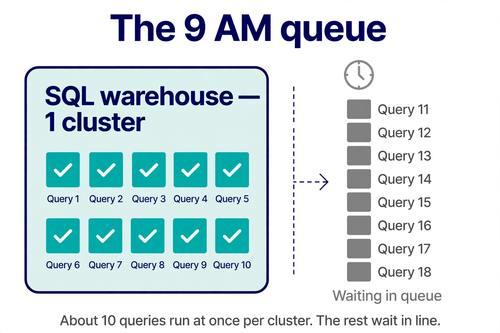
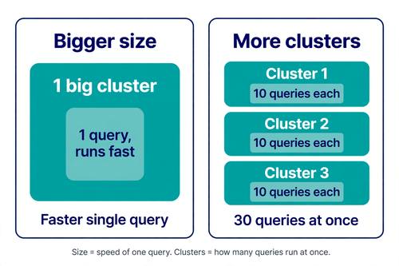
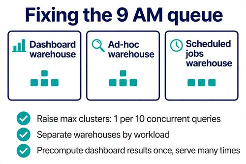

*Part of my daily Databricks series — the hardest topics, explained simply. Also published on [Substack](https://masterdataengineering.substack.com/) and in my LinkedIn newsletter, Master Data Engineering.*

Part of my daily Databricks series — the hardest topics, explained simply.

Ten people open the dashboard at 9 AM: concurrency and queueing on SQL warehouses

Picture this. It is Monday, 9 AM. The leadership meeting starts in ten minutes, and the whole team opens the same sales dashboard at the same time.

The first person in gets their numbers in four seconds. The fifth person waits thirty seconds. The tenth person watches a spinner for two minutes, refreshes, and gets the same spinner.

Nobody changed the dashboard. Nobody ran a bad query. The data is the same size it was on Friday, when the same dashboard loaded instantly. The only thing that changed is that ten people asked for it at once.

This is the moment most teams misdiagnose. They assume the dashboard got slower, or the data got bigger, or the warehouse needs to be bigger. Usually none of that is true. The warehouse was simply full.

Here is the mental model that makes it click. A SQL warehouse is one or more clusters, and each cluster can run about ten queries at the same time. That number is not a setting you tune — it is roughly how the platform is built. Databricks recommends one cluster for every ten concurrent queries.

When the eleventh query arrives and every slot is taken, it does not fail. It waits in a queue. The queue holds up to 1,000 queries, and they run in turn as slots free up.

That is why the symptom is slowness, not an error. Nothing broke. Your query is standing in line, and the line is invisible unless you know where to look.



The most common mistake at this point is buying a bigger warehouse.

Warehouse size and warehouse scaling solve two different problems, and confusing them is expensive. Size decides how fast a single query runs. A Medium warehouse answers one heavy query faster than an X-Small. Scaling — the number of clusters — decides how many queries run at once.

A queue is a scaling problem, not a size problem. A Medium warehouse with one cluster still handles about ten queries at a time. Making it a Large does not add an eleventh slot. It just makes the ten running queries finish a little faster, which helps the queue drain a little sooner — but it does not fix the bottleneck.

If ten people opening a dashboard at 9 AM is your normal morning, you do not need a bigger warehouse. You need more clusters at 9 AM.

The second thing to understand is that autoscaling is reactive. It helps, but it does not prevent the wait.

On a Classic or Pro warehouse, you set a minimum and maximum number of clusters. When the estimated backlog grows, the platform adds clusters: roughly one extra cluster for two to six minutes of queued work, two for six to twelve, three for twelve to twenty-two, and more beyond that. A query that waits five minutes in the queue also triggers a scale-up. When demand stays low for fifteen minutes, clusters scale back down.

On a serverless warehouse, the same job is done by Intelligent Workload Management, which predicts each query's cost and scales out as the queue grows.

Both versions share the same catch: new clusters take time to appear. The first ten people in line still wait while the warehouse grows. Autoscaling shortens the queue. It does not stop the queue from forming.

And there is a detail that catches almost everyone: a new warehouse defaults to a minimum and maximum of one cluster. Concurrency is opt-in. If nobody ever raised the maximum, your warehouse has been a single cluster all along, no matter how many people use it.



So what actually fixes the 9 AM queue? Four things, in order of how much they help.

First, raise the maximum number of clusters before the peak, not after it. The rule is simple: about one cluster per ten concurrent queries. If twenty to fifty people hit the warehouse at once, set the minimum to two and the maximum to five. That is the setting that directly matches your peak.

Second, stop sharing one warehouse between jobs that should not share. The classic setup is a single warehouse serving the executive dashboard, the analysts' ad-hoc queries, and the scheduled refresh jobs. Then one analyst runs a heavy unfiltered scan at 8:58 AM and the leadership dashboard queues behind it.

Separate them. Give the dashboard its own warehouse, give ad-hoc work another, and give scheduled jobs a third if they matter. A heavy query can only block the warehouse it runs on. Separation is the cheapest insurance against a queue caused by someone else's query.

Third, stop running the same query forty times. When ten people open the same dashboard, they are asking for the same numbers. The result cache answers repeat queries instantly without touching the warehouse at all, and a scheduled refresh or materialized view computes the numbers once and serves the stored result to everyone.

This is the fix people skip because it feels like extra work. But it attacks the queue at its source: fewer queries in line means a shorter line for everyone still waiting.

Fourth, watch the right number. The warehouse monitoring page shows Peak Queued Queries. If it sits above zero every morning, your warehouse is too small for your peak — not too slow, too small in clusters. That one metric tells you whether to add clusters, and it tells you when you have added enough, because the peak drops back to zero.

Here is the pattern I see most often, and the fix.

The wrong version is one shared warehouse, default settings, everyone hitting the live dashboard at the same time:

```sql
SELECT region, SUM(revenue) AS total_revenue
FROM sales
GROUP BY region
```

Nothing wrong with the query. The problem is that it runs fresh, on the shared warehouse, once per viewer, at the exact moment everyone wants it.

The fix is not a bigger warehouse. It is a warehouse sized for the peak, separated by workload, with the dashboard numbers precomputed:

```sql
SELECT region, SUM(revenue) AS total_revenue
FROM sales
WHERE sale_date >= current_date() - INTERVAL 90 DAYS
GROUP BY region
```

Filter early, precompute on a schedule, and serve the stored result. The dashboard stops being ten heavy queries at 9 AM and becomes ten instant reads of a number that was already computed.



The queue is not a bug and it is not a sign your warehouse is broken. It is the platform doing exactly what it was configured to do: run about ten queries per cluster, and line the rest up in order.

The teams that never see the spinner are not the ones with the biggest warehouse. They are the ones who counted their peak concurrency, set the maximum clusters to match it, separated the dashboard from the ad-hoc work, and stopped recomputing the same numbers for every viewer.

Check your own warehouse this week. Open the monitoring page and look at Peak Queued Queries for the last seven days. If it is above zero at the same hour every day, you have found your queue — and now you know exactly which setting fixes it.

Which hour does your warehouse queue every day — and how many clusters is it still running with at that hour?
