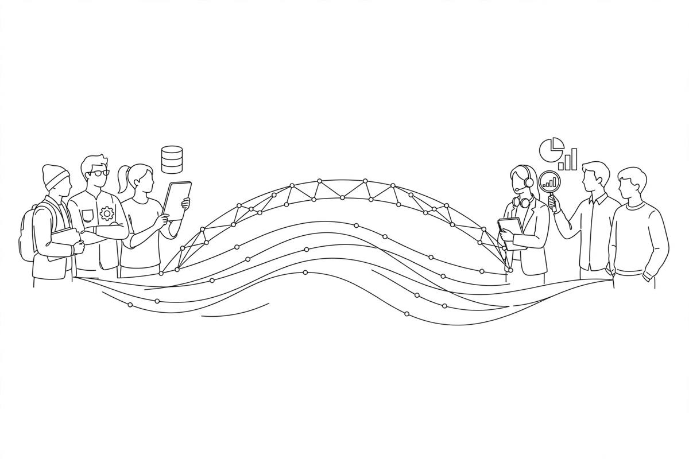

*Part of my daily series on Fundamentals of Data Engineering by Joe Reis and Matt Housley — [read the whole series](/book-series/).*

The hardest part of ingestion was never the connector. It was the people on either side of it.

Ingestion sits at the boundary of the org. Upstream, the software engineers who generate the data. Downstream, the analysts, data scientists, and business teams who need it. And too often those two sides never talk to each other.

The book makes a point I keep coming back to: engineers chase the fancy streaming setup while the team next door is still downloading reports by hand. Basic automation of the boring stuff is worth more than the impressive stuff nobody asked for.

Same upstream. Software teams tend to see data engineers as downstream consumers of their exhaust, not stakeholders. But a five-minute conversation before a schema change saves a week of debugging after it.

From my own work:

Healthcare feeds taught me this the hard way. Partners change file shapes without warning, and nobody tells the pipeline team. Landing the raw file untouched in Delta Lake first meant a renamed column was a fix, not a fire. And building the relationship with the source team — so they flag changes before they ship — did more for reliability than any connector ever did.

The takeaway: ingestion is a people job first and a plumbing job second. Talk to both sides before you pick a tool.

Day 42 of my read-through of Fundamentals of Data Engineering.
