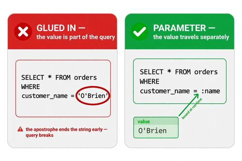
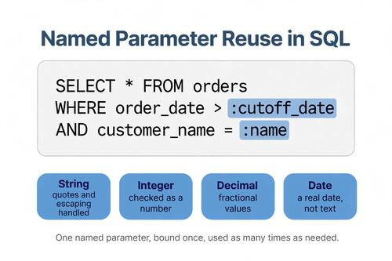
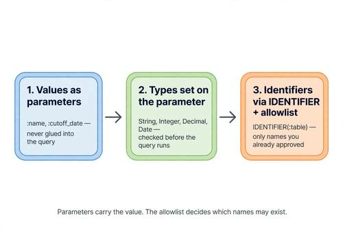

*Part of my daily Databricks series — the hardest topics, explained simply. Also published on [Substack](https://masterdataengineering.substack.com/) and in my LinkedIn newsletter, Master Data Engineering.*

Part of my daily Databricks series — the hardest topics, explained simply.

Stop gluing values into your SQL: parameterized queries in Databricks SQL

Picture this. A small internal tool lets the support team look up a customer's orders. Someone types a name into a box, the tool builds a SQL query, and the results come back.

It works for months. Then one afternoon a customer named O'Brien signs up, support types the name in, and the lookup crashes.

The error complains about a syntax problem near "Brien". Nothing about the data changed. The query was fine yesterday. The only thing that changed is the value inside it — and that value contained an apostrophe.

That is the moment most teams discover how their SQL is really built. The value was never passed to the query. It was glued into the query text, and the query text broke the moment a real-world value stopped behaving like a tidy example.

This pattern is everywhere. A notebook builds a query with an f-string. A scheduled job reads a region name from a config file and pastes it into a WHERE clause. A dashboard filter concatenates whatever the user picked into the SQL. It all works until it doesn't, and when it breaks, it breaks in production, in front of a user, on a value nobody thought to test.

The problem is not the apostrophe. The problem is that the query and the value are the same string.

When you glue a value into SQL text, the database has to guess where the value ends and the query begins. An apostrophe ends the string early. A backslash escapes the next character. A date in the wrong format becomes a different date, or an error. A number with a comma in it stops being a number.

And the worst version of this is not a crash. It is a value that changes what the query means.

If the input comes from a person — a search box, a form field, a URL — then whoever types the input can type SQL. A value like `' OR '1'='1` turns a lookup for one customer into a lookup for every customer. That is SQL injection, and it is not an exotic attack. It is what happens when the query text and the user input are the same string.



The fix is to stop putting values in the query at all. Pass them separately, as parameters.

In Databricks SQL, a named parameter marker is a colon followed by a name, like `:customer_name`. You write the query once, with the marker where the value goes, and you supply the value at run time. The value never becomes part of the query text, so it cannot break the query text. An apostrophe is just a character in a name again.

In the SQL editor, typing `:customer_name` makes a widget appear above the query. You set the type — String, Integer, Decimal, Date — and the value. Databricks handles the quoting for you. For a String parameter, it escapes backslashes and quotation marks automatically and adds the quotes around the value itself.

The same markers work in notebooks, in AI/BI dashboard datasets, in Genie, and through the Statement Execution API. One syntax, everywhere the query runs.

From Python, the same idea looks like this:

```python
spark.sql(
    "SELECT * FROM orders WHERE customer_name = :name",
    args={"name": "O'Brien"}
)
```

The query is a fixed string. The value travels in a separate dictionary. The engine binds the two together at run time, and the apostrophe never gets a chance to end the string early.

Here is the pattern I see most often, and the fix.

The wrong version builds the query with an f-string:

```python
name = "O'Brien"
query = f"SELECT * FROM orders WHERE customer_name = '{name}'"
spark.sql(query)
```

It works for every name without an apostrophe, which is almost every name — right up until the one that has one. And if the name comes from a user, the same line is an injection hole, because the user controls part of the query.

The fix keeps the query fixed and passes the value as a parameter:

```python
spark.sql(
    "SELECT * FROM orders WHERE customer_name = :name",
    args={"name": name}
)
```

Same query, same result, for every name. The apostrophe is data now, not syntax. And no input can rewrite the query, because the input is never part of it.



Parameters have a few rules worth knowing before you rely on them.

First, a parameter is typed, and the type is doing real work. A String parameter gets its quotes and escaping handled for you. An Integer parameter is checked as a number before it reaches the query, so a stray letter fails fast with a clear error instead of silently becoming a different filter. A Date parameter is a date, not a string that happens to look like one.

Second, you can use the same named parameter more than once in a query and bind it once. If the same cutoff date appears in the WHERE clause and in a subquery, you write `:cutoff_date` in both places and supply it once. With unnamed `?` markers, you would have to repeat the value in order for every slot — which is why named markers are the better default.

Third, do not mix the two styles in one statement. A query uses named markers or unnamed markers, not both. Pick named, and stay with it.

Fourth, if a parameter has no value bound to it, the query fails with an UNBOUND_SQL_PARAMETER error. That sounds annoying, and it is — until you realize it is failing loudly at run time instead of silently running with a missing filter. A loud failure beats a quiet wrong answer every time.

So parameters handle values. What about the parts of a query that are not values — the table name, the column name?

A parameter cannot stand in for a table or column name. `:table_name` in a FROM clause is not a table; it is a syntax error. That is by design. Values and structure are different things, and parameters only carry values.

When the table or column genuinely needs to change at run time, wrap the parameter in the IDENTIFIER clause:

```sql
SELECT * FROM IDENTIFIER(:table_name)
```

IDENTIFIER takes the parameter value and treats it as an object name — a table, a column, a catalog, a schema. You can even build a three-level name from three parameters, like IDENTIFIER(:catalog || '.' || :schema || '.' || :table).

But here is the rule that matters: never let raw user input become an identifier.

A value parameter is safe because the value can never change the query. An identifier parameter is not safe in the same way, because the identifier IS part of the query structure. If a user can type any table name they like, they can point your query at a table they should never see.

So identifiers get an allowlist. The code checks the requested name against a short list of names you already approved, and rejects anything else before the query ever runs. Parameters carry the value; the allowlist decides which names are allowed to exist.



Put together, the safe pattern has three parts, and none of them is optional.

Values always travel as parameters, never glued into the query text. Types are set on the parameter, not guessed from the string. And anything that changes the shape of the query — a table name, a column name — goes through IDENTIFIER and an allowlist, never straight from user input.

Most teams already do the first part in the places they remember and skip it in the places they don't. The notebook that builds a report query with an f-string. The scheduled job that reads a date from a file and concatenates it. The dashboard filter that worked fine because nobody typed an apostrophe yet.

Go and look at your own queries this week. Search for f-strings that build SQL, for string concatenation around a WHERE clause, for a dashboard filter that pastes a value into the text. Every one of them is a query waiting for its O'Brien.

Replace the glued-in value with a named parameter. Set the type. Bind the value separately. The query becomes shorter, the failure mode disappears, and the next apostrophe is just a character in a name.

What is the last value that broke one of your queries — and was it glued into the SQL?
